# 3x-ui exporter

[](https://github.com/nike38rus/3x-ui-exporter/actions/workflows/ci.yml)
[](https://github.com/nike38rus/3x-ui-exporter/releases)
[](https://github.com/nike38rus/3x-ui-exporter/pkgs/container/3x-ui-exporter)
[](go.mod)
[](LICENSE)

High-performance, stateless Prometheus exporter for the **[3x-ui](https://github.com/MHSanaei/3x-ui)** control panel and its running **Xray core**.

Provides real-time visibility into traffic throughput, memory and GC behavior, balancer selection and fallback states, and outbound latency health via Xray's Observatory probe statistics.

---

## Table of Contents

- [Overview](#overview)
- [Key Features](#key-features)
- [Architecture](#architecture)
- [Quick Start](#quick-start)
  - [Docker Compose (Recommended)](#docker-compose-recommended)
  - [Prometheus Configuration](#prometheus-configuration)
  - [Binary Execution](#binary-execution)
- [Configuration Reference](#configuration-reference)
- [Metrics Reference](#metrics-reference)
  - [Exporter Diagnostics](#exporter-diagnostics)
  - [Panel and Xray Status](#panel-and-xray-status)
  - [Traffic Statistics](#traffic-statistics)
  - [Balancers and Routing](#balancers-and-routing)
  - [Observatory and RTT](#observatory-and-rtt)
  - [Xray Go Runtime and Memory](#xray-go-runtime-and-memory)
- [Grafana Dashboard](#grafana-dashboard)
  - [Overview Dashboard](#overview-dashboard)
  - [Dashboard Quality Score](#dashboard-quality-score)
- [Technical Principles](#technical-principles)
  - [Endpoint Discovery](#endpoint-discovery)
  - [Balancer Strategy Semantics](#balancer-strategy-semantics)
  - [Fault Isolation and Request Budget](#fault-isolation-and-request-budget)
- [Development and Build](#development-and-build)
- [Disclaimer and Maintenance](#disclaimer-and-maintenance)
- [License](#license)

---

## Overview

Traditional exporters for 3x-ui often rely on periodic background polling, store stale metrics in memory caches, or invoke heavy Xray gRPC RPCs (`StatsService`, `ObservatoryService`, `GetSysStats`) that add unnecessary CPU and synchronization overhead.

**3x-ui-exporter** operates strictly on a **synchronous, pull-based model**:
- Every Prometheus scrape triggers fresh queries across upstream interfaces with an enforced deadline (`SCRAPE_TIMEOUT`).
- All traffic, memory/GC, and observatory measurements are retrieved in **a single lightweight HTTP request** to Xray's internal `/debug/vars` (expvars) endpoint.
- Panel configuration and versions are queried in parallel via 3x-ui REST API.
- Runtime routing and balancers are queried concurrently via public Xray gRPC services.
- If an upstream source fails, independent metrics continue to be served with clear source-level failure indicators (`xui_exporter_scrape_success{source="..."} 0`).

---

## Key Features

- **Zero-Cache & No Stale Data:** Measurements are never cached across scrapes. If a service stops, metrics reflect the failure immediately instead of masking it with historical values.
- **Ultra-Fast Scrape Latency:** Parallel upstream collection and optimized HTTP connection pooling deliver complete scrapes in low single-digit milliseconds ($< 5\text{ ms}$).
- **Automatic Metrics Discovery:** Automatically extracts Xray's `metrics.listen` address directly from current panel settings, with support for explicit URL overrides.
- **Role-Aware Balancer Tracking:** Distinguishes between `primary` targets, configured `fallback` paths, and active `override` states across leastLoad, leastPing, random, and roundRobin strategies.
- **Comprehensive Observatory Insights:** Exports burst observatory probe counts, failure rates, and RTT distributions (mean, min, max, deviation).
- **Hardened Distroless/Scratch Image:** Final Docker image is built `FROM scratch` with a statically linked Go binary: ~15 MB total size, runs as non-root user `65532:65532`, with zero OS packages and zero CVEs.
- **Out-of-the-Box Grafana Dashboards:** Includes production-verified Grafana dashboards (in both Classic and Schema v2 formats) featuring a comprehensive Overview and an automated outbound **Quality Score**.

---

## Architecture

The exporter acts as a bridge between Prometheus and the 3x-ui / Xray ecosystem:

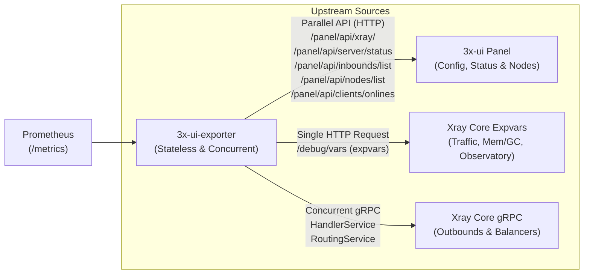

### Upstream Sources at a Glance

| Source | Protocol & Endpoint | Purpose & Retrieved Data |
| --- | --- | --- |
| **`api`** | HTTP REST `POST /panel/api/xray/`<br>`GET /panel/api/server/status`<br>`GET /panel/api/inbounds/list`<br>`GET /panel/api/nodes/list`<br>`POST /panel/api/clients/onlines` | Discovers balancer rules, selector prefixes, subscription outbounds, panel version, Xray version, process state, open TCP/UDP sockets, inbound administrative states, node cluster health, client account lifecycle states, and online clients count. |
| **`expvars`** | HTTP `GET /debug/vars` | Fetches inbound/outbound traffic counters, memory/GC stats, and observatory probe/RTT metrics in **one** roundtrip. |
| **`grpc`** | gRPC `ListOutbounds`<br>`GetBalancerInfo` | Inspects live runtime outbound inventory and queries active balancer selection/override targets concurrently. |
| **`exporter`** | Internal runtime diagnostics | Emits scrape success, collection timing per source, and exporter build version. |

---

## Quick Start

### Docker Compose (Recommended)

The recommended deployment places the exporter alongside 3x-ui by joining the panel's container network namespace. This allows secure, loopback-only communication without exposing Xray's gRPC control port or expvars listener to external networks.

#### Option A: Adding to an existing Compose file

Add the `exporter` service directly to your existing 3x-ui `compose.yaml` (assuming your panel service key is `x-ui`):

```yaml
services:
  x-ui:
    # Your existing 3x-ui service definition
    image: ghcr.io/mhsanaei/3x-ui:latest
    container_name: 3x-ui
    # ...

  exporter:
    image: ghcr.io/nike38rus/3x-ui-exporter:1.0.0
    network_mode: service:x-ui
    depends_on:
      x-ui:
        condition: service_started
        restart: true
    environment:
      XUI_URL: http://127.0.0.1:2053
      XUI_API_TOKEN: ${XUI_API_TOKEN:?Set XUI_API_TOKEN}
      XRAY_API: 127.0.0.1:62789
      # XRAY_METRICS_URL is empty by default to auto-discover metrics.listen
      XRAY_METRICS_URL: ""
      LISTEN_ADDRESS: :9108
      SCRAPE_TIMEOUT: 4s
      LOG_LEVEL: info
      LOG_FORMAT: text
    read_only: true
    cap_drop: [ALL]
    security_opt: [no-new-privileges:true]
    restart: unless-stopped
```

#### Option B: Standalone Compose Deployment

If deploying as a standalone stack against a running 3x-ui container on the same Docker host:

```sh
# Clone repository and prepare environment
cp .env.example .env
# Edit .env to set your XUI_API_TOKEN and XRAY_CONTAINER name
docker compose up -d
```

#### Option C: Full All-in-One Monitoring Stack

If you want to spin up the **entire monitoring infrastructure** (3x-ui-exporter + Prometheus + Grafana with pre-provisioned dashboards) in a single command, see the ready-to-run [Full Monitoring Stack Example](examples/full-monitoring-stack):

```sh
cd examples/full-monitoring-stack
cp .env.example .env
# Edit .env and supply your XUI_API_TOKEN
docker compose up -d
```
Grafana will be immediately available at `http://localhost:3000` with the 3x-ui dashboard preloaded.

### Prometheus Configuration

Add the scrape job to your `prometheus.yml`:

```yaml
scrape_configs:
  - job_name: xui-exporter
    scrape_interval: 5s
    scrape_timeout: 5s
    static_configs:
      - targets: ["127.0.0.1:9108"]
```

> [!NOTE]
> Ensure that Prometheus's `scrape_timeout` is slightly greater than or equal to the exporter's `SCRAPE_TIMEOUT` (e.g. 5s scrape timeout vs 4s exporter deadline).

### Binary Execution

You can run the static binary directly on the host or inside a virtual machine:

```sh
export XUI_URL=http://127.0.0.1:2053
export XUI_API_TOKEN="your-panel-api-token"
export XRAY_API=127.0.0.1:62789
export LISTEN_ADDRESS=:9108
export SCRAPE_TIMEOUT=4s

./bin/3x-ui-exporter
```

---

## Configuration Reference

All settings can be configured via command-line flags or environment variables. CLI flags take precedence over environment variables.

| CLI Flag | Environment Variable | Default | Description |
| --- | --- | --- | --- |
| `--xui-url` | `XUI_URL` | *None (Required)* | 3x-ui panel base URL, including optional base path (e.g. `http://127.0.0.1:2053`). |
| `--xui-api-token` | `XUI_API_TOKEN` | *None (Required)* | 3x-ui Bearer API token. Prefer environment variable to prevent process list exposure. |
| `--xray-api` | `XRAY_API` | `127.0.0.1:62789` | Xray gRPC host and port (`host:port`). |
| `--xray-metrics-url` | `XRAY_METRICS_URL` | `""` *(empty)* | Xray expvars HTTP base URL. If empty, automatically discovered from panel `metrics.listen`. |
| `--listen-address` | `LISTEN_ADDRESS` | `:9108` | Address and port for the exporter HTTP server to bind. |
| `--scrape-timeout` | `SCRAPE_TIMEOUT` | `4s` | Total deadline per scrape request across all upstream sources. |
| `--log-level` | `LOG_LEVEL` | `info` | Log verbosity level: `debug`, `info`, `warn`, `error`. |
| `--log-format` | `LOG_FORMAT` | `text` | Log format output: `text` or `json`. |
| `--collect-client-stats` | `COLLECT_CLIENT_STATS` | `false` | When `true`, parses individual user/client counters into `xui_client_traffic_bytes_total`. |
| `--version` | — | `false` | Prints exporter version and exits. |

---

## Metrics Reference

All metrics are prefixed with `xui_`. Missing or unknown measurements remain absent (never synthesized as zero unless confirmed by Xray).

### Exporter Diagnostics

Diagnostics describe the collection process itself. All three source series are emitted on every scrape.

| Metric | Type | Labels | Description |
| --- | --- | --- | --- |
| `xui_exporter_scrape_success` | Gauge | `source` (`api`, `expvars`, `grpc`) | `1` if source requests succeeded and satisfied contract; `0` on error. |
| `xui_exporter_scrape_duration_seconds` | Gauge | `source` (`api`, `expvars`, `grpc`) | Elapsed wall-clock time spent querying this source in the current scrape. |
| `xui_exporter_build_info` | Gauge | `version` | Always `1`. Identifies the running exporter version. |

### Panel, Node Cluster, and Inbound Status

Derived from 3x-ui REST API (`GET /panel/api/server/status`, `POST /panel/api/clients/onlines`, `GET /panel/api/inbounds/list`, `GET /panel/api/nodes/list`).

| Metric | Type | Labels | Description |
| --- | --- | --- | --- |
| `xui_panel_info` | Gauge | `version` | Always `1`. Panel version reported by 3x-ui. |
| `xui_xray_info` | Gauge | `version` | Always `1`. Xray binary version reported by the panel. |
| `xui_xray_state` | Gauge | `state` (`running`, `stop`, `error`) | `1` for the active state, `0` for inactive states. |
| `xui_open_sockets` | Gauge | `protocol` (`tcp`, `udp`) | Current open network sockets reported by the panel environment. |
| `xui_client_online` | Gauge | — | Current active client sessions across the cluster reported by panel. |
| `xui_client_count` | Gauge | `state` (`active`, `disabled`, `expired`, `depleted`) | Total configured client accounts in the panel database by lifecycle state. |
| `xui_inbound_enabled` | Gauge | `inbound`, `remark`, `node` | `1` if inbound is administratively enabled in the panel; `0` if disabled. Enriched with inbound remark and node name (`local` for master panel). |
| `xui_inbound_bytes_total` | Counter | `inbound`, `remark`, `node`, `direction` (`uplink`, `downlink`) | Cumulative inbound traffic bytes across all nodes reported by the panel database. |
| `xui_node_online` | Gauge | `node` | `1` if remote node is reported online by master panel heartbeat; `0` if offline. |
| `xui_node_online_clients` | Gauge | `node` | Current active clients online connected to this node reported by panel (`local` for master panel). |
| `xui_node_latency_seconds` | Gauge | `node` | Round-trip latency between master panel and remote node in seconds. |
| `xui_node_xray_state` | Gauge | `node`, `state` (`running`, `stop`, `error`) | Remote node Xray core state captured during heartbeat. |
| `xui_node_cpu_percent` | Gauge | `node` | Remote node CPU utilization percent. |
| `xui_node_memory_percent` | Gauge | `node` | Remote node memory utilization percent. |
| `xui_node_uptime_seconds` | Gauge | `node` | Remote node uptime in seconds. |
| `xui_node_info` | Gauge | `node`, `xray_version`, `panel_version` | Always `1`. Remote node software version metadata. |

> [!NOTE]
> Client account states (`xui_client_count`) are mutually exclusive and deduplicated across inbounds:
> - `active`: Account is administratively enabled, not expired, and traffic quota is not exhausted.
> - `disabled`: Administratively disabled (`enable: false`).
> - `expired`: Expiration timestamp elapsed (`expiryTime <= now`).
> - `depleted`: Cumulative traffic meets or exceeds configured quota (`up + down >= total`).

### Traffic Statistics

Derived from Xray expvars (`stats.inbound`, `stats.outbound`, and optional `stats.user`).

| Metric | Type | Labels | Description |
| --- | --- | --- | --- |
| `xui_inbound_traffic_bytes_total` | Counter | `inbound`, `direction` (`uplink`, `downlink`) | Cumulative bytes traversing the inbound handler. |
| `xui_outbound_traffic_bytes_total` | Counter | `outbound`, `direction` (`uplink`, `downlink`) | Cumulative bytes traversing the outbound handler. |
| `xui_client_traffic_bytes_total` | Counter | `client`, `direction` (`uplink`, `downlink`) | Cumulative bytes per user email/tag (enabled via `--collect-client-stats`). |

> [!TIP]
> Use PromQL `rate()` or `increase()` over traffic counters to calculate network throughput (bytes per second).

### Balancers and Routing

Derived from panel routing configuration and runtime Xray gRPC `RoutingService`.

| Metric | Type | Labels | Description |
| --- | --- | --- | --- |
| `xui_balancer_outbound_selected` | Gauge | `balancer`, `outbound`, `role` (`primary`, `fallback`, `override`) | `1` if selected/active; `0` if inactive. |
| `xui_balancer_outbound_available` | Gauge | `balancer` | `1` if balancer resolves to an available runtime outbound (structural check). |

#### Selection Roles

- **`primary`:** Represents known selector candidates. `1` for the currently preferred target, `0` for others.
- **`fallback`:** Emitted when `fallbackTag` is configured. `1` when primary selection is empty and no override is active; otherwise `0`.
- **`override`:** `1` when runtime override is active, `0` otherwise.

### Observatory and RTT

Derived from Xray expvars (`observatory`). Supports ordinary observatory and HealthPing burstObservatory.

| Metric | Type | Labels | Description |
| --- | --- | --- | --- |
| `xui_observatory_outbound_alive` | Gauge | `outbound` | `1` = alive, `0` = unreachable according to Xray probes. |
| `xui_observatory_outbound_delay_seconds` | Gauge | `outbound` | Delay in seconds. Latest probe (ordinary) or window average (burst). Omitted if not alive. |
| `xui_observatory_outbound_rtt_mean_seconds` | Gauge | `outbound` | Mean RTT across the observation window in seconds. |
| `xui_observatory_outbound_rtt_min_seconds` | Gauge | `outbound` | Minimum RTT in the burst window in seconds. |
| `xui_observatory_outbound_rtt_max_seconds` | Gauge | `outbound` | Maximum RTT in the burst window in seconds. |
| `xui_observatory_outbound_rtt_deviation_seconds` | Gauge | `outbound` | RTT deviation in the burst window in seconds. |
| `xui_observatory_outbound_probe_samples` | Gauge | `outbound` | Total probes executed in the current burst window. |
| `xui_observatory_outbound_probe_failed_samples` | Gauge | `outbound` | Failed probes in the current burst window. |

### Xray Go Runtime and Memory

Derived from Xray expvars (`memstats`). Measures the memory footprint of the proxied Xray core process (not the exporter).

| Metric | Type | Description |
| --- | --- | --- |
| `xui_xray_memory_alloc_bytes` | Gauge | Bytes allocated on heap currently in use (`Alloc`). |
| `xui_xray_memory_sys_bytes` | Gauge | Total bytes obtained from the OS by the runtime (`Sys`). |
| `xui_xray_memory_alloc_bytes_total` | Counter | Cumulative bytes allocated for heap objects (`TotalAlloc`). |
| `xui_xray_memory_mallocs_total` | Counter | Cumulative count of allocated heap objects. |
| `xui_xray_memory_frees_total` | Counter | Cumulative count of freed heap objects. |
| `xui_xray_memory_live_objects` | Gauge | Current count of live allocated heap objects. |
| `xui_xray_gc_cycles_total` | Counter | Number of completed garbage collection cycles. |
| `xui_xray_gc_pause_seconds_total` | Counter | Cumulative GC stop-the-world pause duration in seconds. |

---

## Grafana Dashboard

The repository includes pre-built, production-tested Grafana dashboards:
- **`grafana-3x-ui.classic.json`**: Standard classic dashboard format (recommended for most installations).
- **`grafana-3x-ui.v2.json`**: Exported for Grafana resource schema v2.

### Overview Dashboard

The default view surfaces Xray state, versions, target health, balancer modes, observed outbound health, and aggregate throughput:

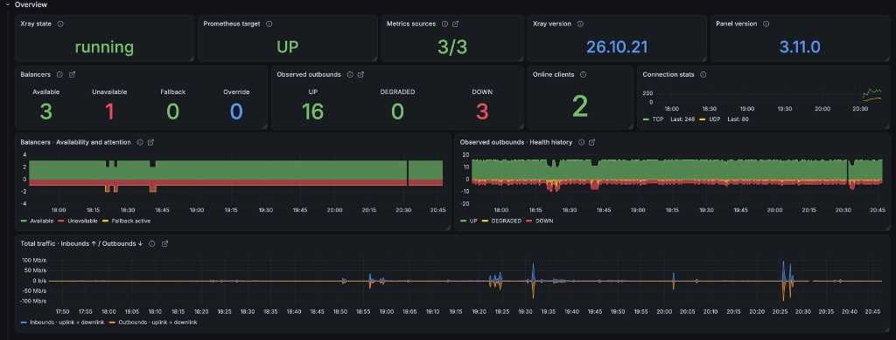

<details>
<summary>Click to view detailed section screenshots</summary>

#### Balancer Selection History
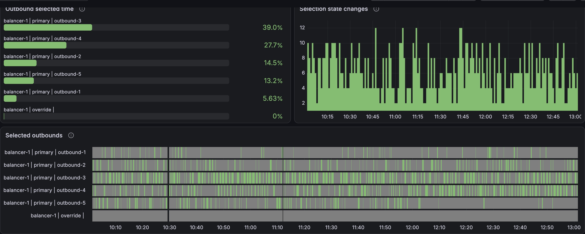

#### Balancer Availability
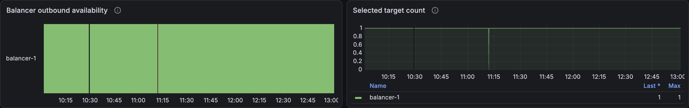

#### Observatory Health
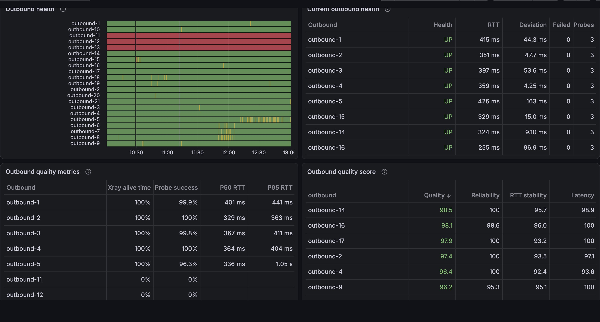

#### Observatory Latency & Burst Probes
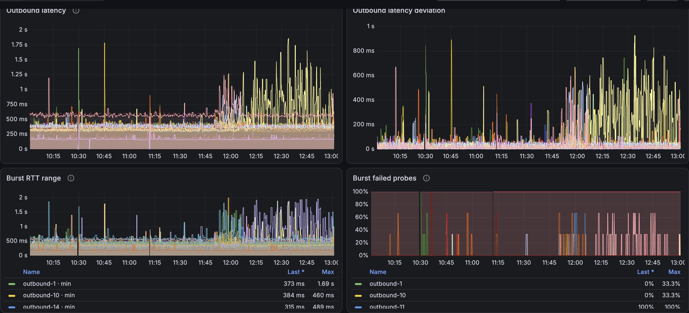

#### Inbound Throughput
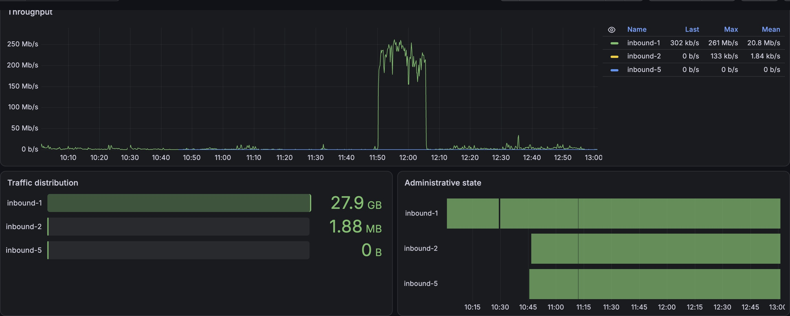

#### Outbound Throughput
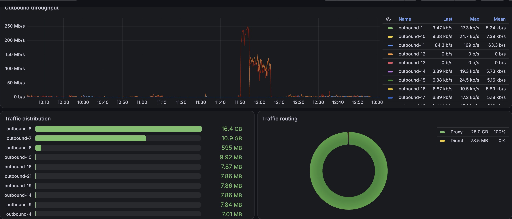

#### Connected Nodes
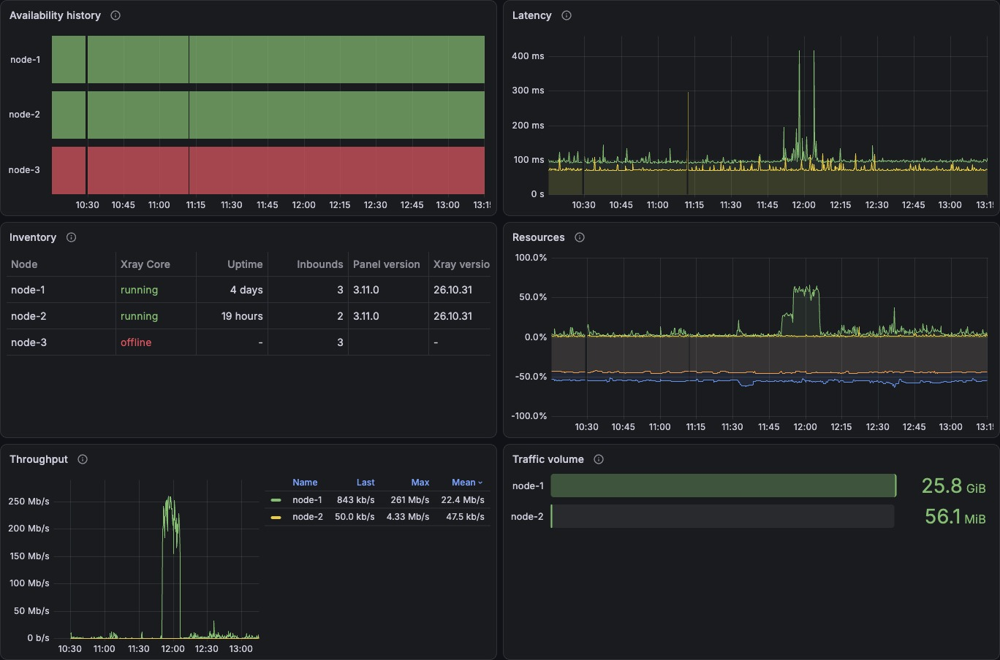

#### Garbage Collection
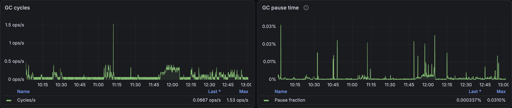

#### Exporter Diagnostics
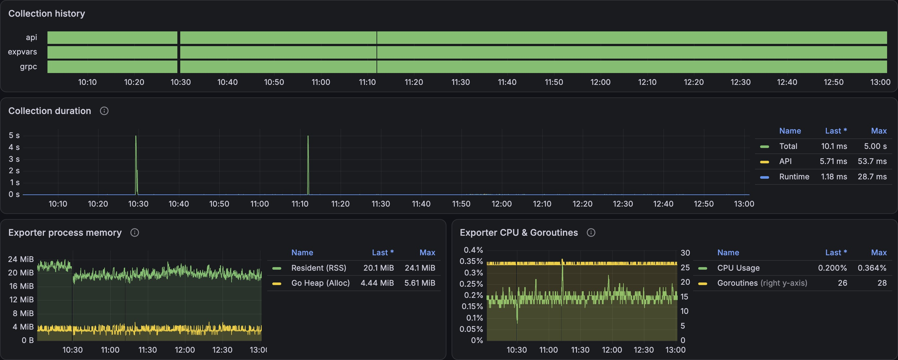

</details>

### Dashboard Quality Score

The dashboard calculates an outbound **Quality Score** (0–100, higher is better) using burst observatory window statistics over the selected dashboard time range (`$__range`).

Rather than looking at raw ping numbers in isolation, the score combines probe success, latency consistency, and speed into a single intuitive metric.

$$\text{Quality} = 100 \cdot \left(\frac{R}{100}\right)^{0.50} \cdot \left(\frac{S}{100}\right)^{0.30} \cdot \left(\frac{L}{100}\right)^{0.20}$$

#### How It Works

The score is computed as a **weighted geometric mean** of three components:

1. **Reliability ($R$, weight 50%): Can packets get through?**
   - Formula: $R = 100 \cdot e^{-10 \cdot f}$, where $f = \frac{\sum \text{failed probes}}{\sum \text{total probes}}$ is the probe failure ratio.
   - **In plain terms:** Measures packet loss during health probes. Packet drops are penalized heavily on an exponential scale:
     - **0% packet loss** $\rightarrow$ **100** points (perfect)
     - **3% packet loss** $\rightarrow$ **~74** points
     - **5% packet loss** $\rightarrow$ **~60** points
     - **10% packet loss** $\rightarrow$ **~37** points
     - **25%+ packet loss** $\rightarrow$ **< 10** points
   - *Rationale:* A proxy route that drops connections is frustrating to use, no matter how fast its successful pings are.

2. **RTT Stability ($S$, weight 30%): Does latency jump around?**
   - Formula: $S = 100 \cdot e^{-2 \cdot (P_{95} - P_{50})}$
   - **In plain terms:** Measures jitter and latency spikes by calculating the spread between worst-case tail latency (95th percentile, $P_{95}$) and typical median latency (50th percentile, $P_{50}$):
     - **Consistent latency** (e.g. median 100 ms, tail 130 ms, spread = 30 ms) $\rightarrow$ **~94** points.
     - **Erratic spikes** (e.g. median 100 ms, tail 800 ms, spread = 700 ms) $\rightarrow$ drops to **~25** points.
   - *Rationale:* High jitter causes stuttering in voice/video calls, game rubber-banding, and stalled web page loads.

3. **Latency ($L$, weight 20%): How fast is it?**
   - Formula: $L = \text{clamp}(130 - 100 \cdot P_{50}, 0, 100)$
   - **In plain terms:** Rewards low median response time ($P_{50}$):
     - Latency **$\le$ 300 ms** receives the full **100** points.
     - Above **300 ms**, the score decreases linearly (10 points lost for each additional 100 ms).
     - Latency **$\ge$ 1.3 seconds** receives **0** points.
   - *Rationale:* Web browsing feels fast under 300 ms, so an outbound with 60 ms is not penalized relative to 180 ms, but multi-second roundtrips are penalized.

#### Why Geometric Mean?

In a standard arithmetic average, a completely dead outbound ($R = 0$) could still score $50$ points if latency and stability happened to look acceptable. 

With a **geometric mean**, if *any* single component collapses to zero, the entire overall score drops to zero. An outbound must be reliable, stable, *and* reasonably fast to earn a high score.

#### Score Interpretation

| Score | Rating | Meaning |
| --- | --- | --- |
| **90 – 100** | 🟢 Excellent | Zero packet loss, rock-solid latency, fast response. Ideal for gaming and VoIP. |
| **70 – 89** | 🟡 Good | Highly reliable with minor jitter or moderate latency. Great for streaming and browsing. |
| **40 – 69** | 🟠 Degraded | Noticeable packet loss or severe latency spikes. May cause buffering or slow page loads. |
| **0 – 39** | 🔴 Critical | High failure rate or extreme lag. Outbound needs investigation or fallback activation. |

---

## Technical Principles

### Endpoint Discovery

When `XRAY_METRICS_URL` is omitted, the exporter inspects `metrics.listen` in the panel settings retrieved during the current scrape:
- `0.0.0.0:PORT` or `:PORT` is normalized to `http://127.0.0.1:PORT`.
- `[::]:PORT` is normalized to `http://[::1]:PORT`.
- Loopback addresses require the exporter to share Xray's container network namespace or host network.
- Discovery does not guess ports or reuse stale addresses across scrapes. If discovery fails or settings are unavailable, `source="expvars"` emits success `0`. Setting an explicit `XRAY_METRICS_URL` removes panel dependency.

### Balancer Strategy Semantics

| Strategy | Primary Selection | Configured Fallback | Override Activity |
| --- | --- | --- | --- |
| **leastLoad** | Fully Supported | Supported | Supported |
| **leastPing** | Supported by API / Tests | Supported | Supported |
| **random** | Omitted *(unknown)* | Omitted *(unknown)* | Supported |
| **roundRobin** | Omitted *(unknown)* | Omitted *(unknown)* | Supported |

Xray's `GetBalancerInfo` exposes candidate pools, not actual connection logs, for `random` and `roundRobin`. We intentionally omit primary and fallback selection for these strategies unless an override is actively set.

### Fault Isolation and Request Budget

- Scrapes are bound by a strict context deadline (`SCRAPE_TIMEOUT`).
- Upstream requests run concurrently:
  - Total collection time is bounded by $\max(T_{api}, T_{expvars}, T_{grpc})$.
  - Independent sources survive sibling failures.
- Normal request budget:
  - 5 panel API requests (`POST /panel/api/xray/`, `GET /panel/api/server/status`, `GET /panel/api/inbounds/list`, `GET /panel/api/nodes/list`, `POST /panel/api/clients/onlines`)
  - 1 expvars HTTP request (`GET /debug/vars`)
  - 1 `ListOutbounds` gRPC call + $N$ parallel `GetBalancerInfo` calls (where $N$ is the count of configured balancers).

---

## Development and Build

### Prerequisites

- Go 1.24+ (uses `testing/synctest`)
- Docker (optional, for container builds)

### Common Make Targets

```sh
# Prepare build cache and download dependencies
make download

# Run tests with race detector and go vet
make test

# Build native binary into bin/3x-ui-exporter
make build

# Cross-compile static Linux binaries for amd64 and arm64
make linux

# Refresh third-party license notices
make licenses

# Package release archives with checksums
make release VERSION=v0.6.1
```

---

## Disclaimer and Maintenance

This project was developed for personal infrastructure and is provided as-is, without any maintenance contract, SLA, or warranty of ongoing support.

Issues and pull requests are welcome, but please note that maintenance and code reviews are handled on a best-effort basis without strict timelines or service-level guarantees.

---

## License

- Exporter code is licensed under the [MIT License](LICENSE).
- Unmodified, linked Xray components are licensed under [MPL-2.0](https://github.com/XTLS/Xray-core).
- Third-party dependencies retain their respective licenses; see [THIRD_PARTY_NOTICES.md](THIRD_PARTY_NOTICES.md) and [third_party_licenses/](third_party_licenses/).
