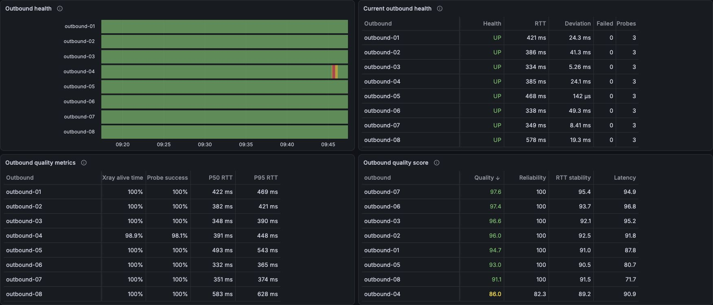
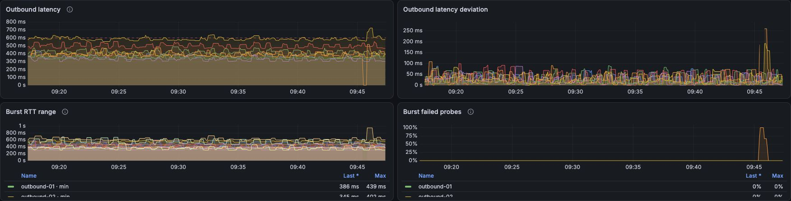
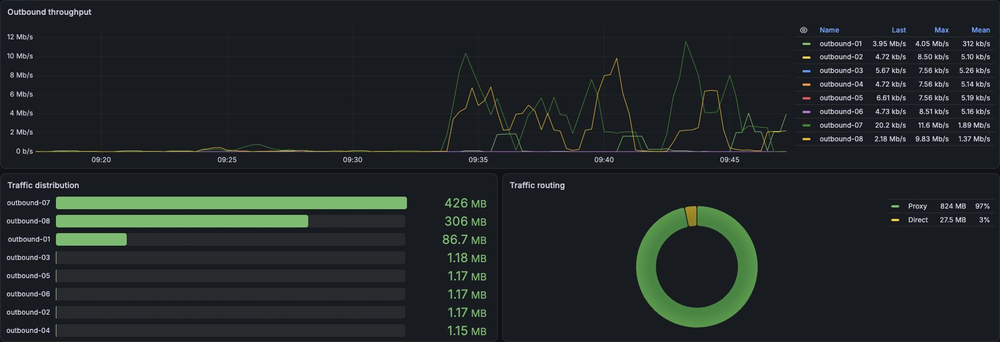
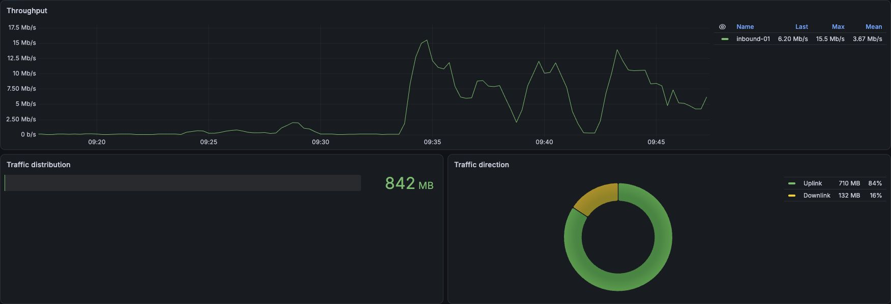
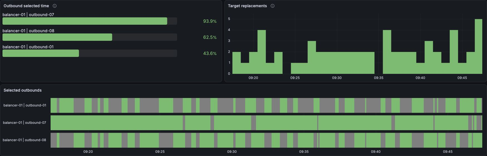
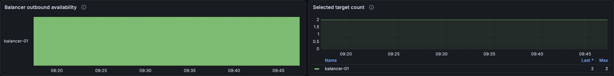
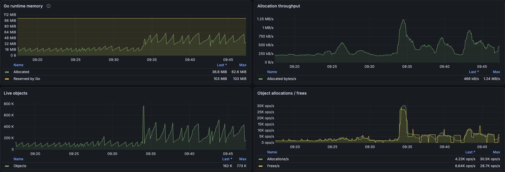
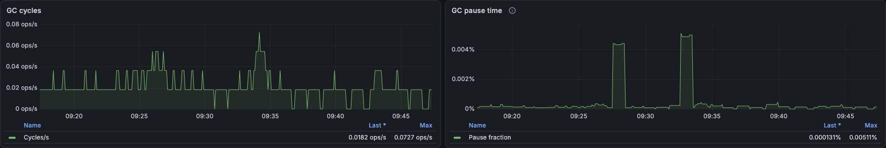
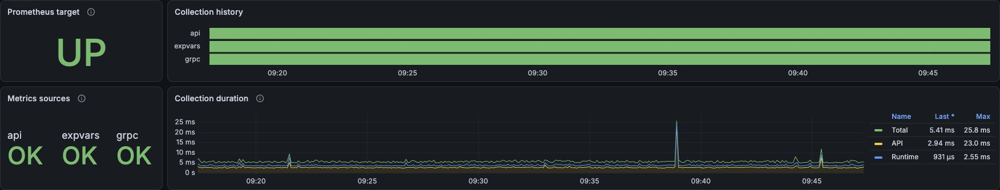

# 3x-ui exporter

## Disclaimer and maintenance policy

This project is **100% vibe-coded with AI**. It was built for my own setup and
is shared as-is, with no promise of support, ongoing maintenance or future releases.
I may make changes if and when I need them myself.

**Issues will not be read, and pull requests are unlikely to be reviewed or merged.**
Do not rely on this repository for fixes or feature requests. If the project does
not meet your needs, fork it and adapt it for yourself.

## Overview

Synchronous Prometheus exporter for 3x-ui and its running Xray core. One HTTP
API source discovers configuration; gRPC reads runtime outbounds and balancers.
One HTTP expvars response supplies traffic, memory/GC and observatory results. No polling loop, exporter configuration file, or stale cache.

## Dashboard preview

Actual Grafana screenshots with anonymized outbound, inbound and balancer names.
Aliases are applied to query results; measurements and charts are not retouched.
Private addresses and browser controls are excluded.

Outbound health and quality:



<details>
<summary>Observatory: latency and probe history</summary>



</details>

<details>
<summary>Outbounds: throughput, traffic distribution and routing</summary>



</details>

<details>
<summary>Inbounds: throughput, traffic distribution and direction</summary>



</details>

<details>
<summary>Balancers: target selection, replacements and availability</summary>





</details>

<details>
<summary>Xray process: memory, allocations and garbage collection</summary>





</details>

<details>
<summary>Exporter: target status, collection history and duration</summary>



</details>

## Run

```sh
export XUI_URL=http://panel.example:2053
export XUI_API_TOKEN='<token>'
export XRAY_API=127.0.0.1:62789
export XRAY_METRICS_URL=http://127.0.0.1:11111
export LISTEN_ADDRESS=127.0.0.1:9108
export SCRAPE_TIMEOUT=4s
./bin/3x-ui-exporter
```

All settings have matching CLI flags (`--xui-url`, `--xui-api-token`,
`--xray-api`, `--xray-metrics-url`, `--listen-address`, `--scrape-timeout`). CLI overrides environment.
Prefer an environment variable for the token, to keep it out of process arguments.
The base URL can include a panel base path. HTTP redirects are rejected; secrets
and configuration contents are never logged.

Endpoints: `/metrics`, `/healthz` (exporter liveness only), `/` (landing page).
The collector shares a total deadline per HTTP request. Failed source collection
still returns HTTP 200 with source status and independent successful metrics.
Source startup failures do not terminate the exporter.

Xray gRPC must provide HandlerService and RoutingService. StatsService is not used.
ObservatoryService and GetSysStats are not used. Traffic, memory/GC and observatory results come from
`XRAY_METRICS_URL/debug/vars` (default base URL `http://127.0.0.1:11111`).
Enable Xray metrics in the panel and use a reachable base URL when the exporter
does not share Xray's network namespace. The panel token is never sent to expvars.
If API discovery shows an empty/missing metrics.listen, expvars
collection is disabled: its source gauges and observations are absent.
A successful empty or missing observatory object produces no observations;
HTTP/JSON errors set only expvars source success to zero. Xray traffic policies determine
which counters exist; missing counters are never synthesized. API configuration
is discovery data, not proof that runtime has the same configuration.

## Metrics

* `xui_balancer_outbound_selected{balancer,outbound}`: current leastLoad or
  leastPing target membership; override takes priority. Zeros only for matching
  runtime selector candidates. Selected targets outside selector are retained.
  An empty choice or absent runtime balancer produces no selection series.
* `xui_balancer_outbound_available{balancer}`: a selected target or fallback
  resolves to an existing runtime outbound, not proof of internet access.
  Unconditional loopback chains are resolved with cycle detection. Conditional
  loopback routes cannot be resolved without a routing context and cause a
  balancer collection error. OutboundTag takes precedence over BalancerTag.
* `xui_inbound_traffic_bytes_total{inbound,direction}` and
  `xui_outbound_traffic_bytes_total{outbound,direction}`: counters with `uplink`
  and `downlink`. Read exclusively from expvars stats. Missing traffic stays
  absent; there are no alternate-source requests. User counters are excluded.
* `xui_observatory_outbound_alive{outbound}`: observer alive state.
* `xui_observatory_outbound_delay_seconds{outbound}`: Xray delay (last ordinary
  success or burst average). Failed/sentinel measurements are omitted.
* `xui_observatory_outbound_rtt_{mean,min,max,deviation}_seconds{outbound}`:
  burst statistics, only with HealthPing and successful samples.
* `xui_observatory_outbound_probe_samples{outbound}` and
  `xui_observatory_outbound_probe_failed_samples{outbound}`: window gauges,
  not cumulative counters. LastSeen/LastTry are not exported.
* `xui_xray_*`: eight memory/GC fields from expvars memstats, with unchanged
  names and types. HeapObjects supplies memory_live_objects. Uptime and
  goroutines are intentionally absent. Go runtime memory is not RSS.
* `xui_exporter_scrape_success{source="api|grpc|expvars"}` and
  `xui_exporter_scrape_duration_seconds{source="api|grpc|expvars"}`: source gauges.
* `xui_exporter_build_info{version}`: constant build information.

No missing measurements are filled with zeros. Confirmed zero values and boolean
false states are published. Every scrape constructs fresh metrics. Histograms,
quality scores, and exporter-maintained switch counters are intentionally absent.

### Strategy limitations

Xray GetBalancerInfo exposes candidate lists, not actual targets, for random and
roundRobin. Their `outbound_selected` is omitted unless an override is active.
They still expose structural outbound availability. This is not a health guarantee.
For leastLoad/leastPing, principle targets represent current strategy preference,
not a log of routed connections. Runtime routing reads use
public Xray gRPC services and protobuf packages pinned to the v26.9.30 commit.
One expvars request is shared by all HTTP metric groups. Valid groups survive
malformed siblings; the source success gauge is zero for incomplete decoding.

## Build and test

```sh
make test
make build
make linux
docker build -t 3x-ui-exporter:dev .
```

The Docker image contains all dependencies and runs unprivileged. Use a read-only
filesystem and drop capabilities (see compose.yaml). For placement alongside
Xray, prefer its container network namespace; no LAN exposure of gRPC is needed.
See VERIFICATION.md for tested scenarios and compatibility scope.

Read-only live checks: `XUI_TEST_EXPVARS_URL=http://xray.example:11111 make test`
and `XUI_TEST_GRPC=host:port XUI_TEST_BALANCER=test-balancer make test`.

## Dashboard queries

Selected time (%), instant query:

```promql
100 * avg_over_time(xui_balancer_outbound_selected{balancer=~"$balancer"}[$__range])
```

Timeline (range query, actual step aligned to scrape interval):

```promql
xui_balancer_outbound_selected{balancer=~"$balancer"}
```

State timeline: fixed color mode, value mappings 0=gray/Not selected and
1=green/Selected, mergeValues=true. Time percentages require regular complete
scrapes. Multiple selected targets may sum above 100%.

Changes in the preceding minute (minute query step, bars aligned before):

```promql
sum by (instance,balancer) (changes(xui_balancer_outbound_selected[1m])) / 2
```

Division by two assumes constant selected-set size and stable series inventory.
Minute boundaries and scrape gaps limit accuracy; this is observed membership
change, not a connection-switch log.

## Collection timing

API and expvars durations measure their own request/decoding work. gRPC duration
measures only balancer/outbound collection; waiting for API and expvars is
excluded. Prometheus scrape_duration_seconds remains the complete duration.
Operations taking 100 ms or longer emit a warning without secrets.

## Request budget and failures

With N>0 configured balancers: one API request, one HTTP expvars request when
enabled, one ListOutbounds and N GetBalancerInfo calls: N+3 total. For two
balancers with expvars enabled, this is always five calls, including when
expvars fails. No balancers means no gRPC calls. GetSysStats and QueryStats
are never called.

Every metric has exactly one source: API for configuration discovery, gRPC
for runtime outbound inventory and balancers, expvars for traffic, memory/GC
and observation. No caching, source switching or alternate-source fallback collection.
Missing data remains absent. Valid groups survive malformed siblings; decoding
errors set expvars success to zero. Empty or missing optional groups produce
no measurements. Explicitly disabled sources have no status/duration series.

## Panel settings discovery

Each scrape calls POST /panel/api/xray/ with the API token. The exporter reads
the saved xraySetting template and subscriptionOutbounds, excludes disabled
routing rules (preserving the internal API rule), and removes UI-only rule
metadata. This avoids full configuration generation and traffic maintenance
performed by getConfigJson. Runtime inventory and balancer state still come
from gRPC. Settings are not cached and do not prove they were applied to Xray.

## Docker Compose

The example shares the network namespace of an existing Xray/3x-ui container
on the same Docker host. Set XRAY_CONTAINER to its actual container name.
The exporter listens on port 9108 in that namespace; no separate port mapping
is needed. In a bridge deployment, publish 9108 from the Xray container;
with macvlan, use that container IP. After recreating the Xray container, recreate this exporter too so it joins
the current network namespace.

```sh
cp .env.example .env
# Edit .env: set the token, container name and addresses.
docker compose up -d
```

The default image tag is 0.1.0. To use the latest successful main build, set
`EXPORTER_VERSION=edge` in `.env`. The `edge` tag is updated after each
successful main pipeline.
To build your checkout locally:

```sh
docker compose -f compose.yaml -f compose.build.yaml up -d --build
```

When both services belong to the same Compose project, use the **service key**
from `services:` instead of the container name. Add this exporter service to your
existing Compose file (here the panel service key is `x-ui`):

```yaml
services:
  # Your existing x-ui service remains here.
  exporter:
    image: ghcr.io/nike38rus/3x-ui-exporter:0.1.0
    network_mode: service:x-ui
    depends_on:
      x-ui:
        condition: service_started
        restart: true
    environment:
      XUI_URL: http://127.0.0.1:2053
      XUI_API_TOKEN: ${XUI_API_TOKEN:?Set XUI_API_TOKEN}
      XRAY_API: 127.0.0.1:62789
      XRAY_METRICS_URL: http://127.0.0.1:11111
      LISTEN_ADDRESS: :9108
      SCRAPE_TIMEOUT: 4s
    read_only: true
    cap_drop: [ALL]
    security_opt: [no-new-privileges:true]
    restart: unless-stopped
```

`network_mode: service:x-ui` establishes startup ordering. The explicit dependency
also requests an exporter restart after Compose-controlled updates/restarts of
the panel; it does not supervise automatic Docker Engine restarts. API readiness
is not required at exporter startup: unavailable sources are retried on each
scrape. Separate Compose projects must use the `container:` example instead.

The example uses port 9108; override LISTEN_ADDRESS in Compose if it conflicts
with another exporter. SCRAPE_TIMEOUT must be shorter than the Prometheus timeout.

```yaml
scrape_configs:
  - job_name: xui-exporter
    scrape_interval: 5s
    scrape_timeout: 5s
    static_configs:
      - targets: ["xray.example:9108"]
```

The metrics endpoint has no authentication. Keep it on a trusted monitoring
network. The panel token needs permission to POST /panel/api/xray/; an admin
API token is supported. Do not expose the Xray gRPC control port to the internet.

## Grafana dashboards

Import grafana-3x-ui.classic.json for the classic dashboard JSON format, or
use grafana-3x-ui.v2.json with Grafana resource schema v2 support. They are two
exports of the same dashboard, not two dashboards to install simultaneously.
Choose your Prometheus datasource on import; the supplied queries expect
job="xui-exporter". Select an instance, then outbound/balancer filters.
Dashboards were exported from Grafana 13.2; older versions are not guaranteed
compatible. The classic format is the more widely supported import option.

Quality scores in Grafana are dashboard heuristics, not the Xray balancer score.
Collection duration stacks API + max(gRPC, expvars); Total is the separate
scrape_duration_seconds measurement made by Prometheus.

## Continuous integration

GitHub Actions runs on pushes to main, pull requests and manual dispatches.
Independent jobs check Go formatting, module files, race tests, go vet,
third-party notices, workflow syntax, dashboard JSON and Git history for secrets.
CI also builds Linux amd64/arm64 binaries and a Docker image, then checks the
packaged version, health endpoint and metrics response with an unavailable panel.
The container runs with a read-only filesystem and no Linux capabilities.
After all checks pass on main, CI uploads Linux amd64/arm64 archives and SHA-256
checksums as an Actions artifact (retained for 14 days). It also publishes the
multi-architecture image `ghcr.io/nike38rus/3x-ui-exporter:edge` and a
`sha-<full-commit-SHA>` tag. Development builds report version
`v0.0.0-dev.<short-commit-SHA>`. Pull requests never publish images or artifacts.

## Releases

CI checks pull requests and main. Pushing a vMAJOR.MINOR.PATCH tag runs tests,
builds static Linux amd64/arm64 archives with SHA-256 checksums, creates a
GitHub release and publishes a multi-architecture GHCR image. A tag such as
v0.1.0 produces ghcr.io/nike38rus/3x-ui-exporter:0.1.0. The first GHCR package
may need its visibility set to public in GitHub package settings.

Build locally with make release VERSION=v0.1.0. Archives include dashboards,
README with its screenshot assets, LICENSE and third-party notices. Build version is embedded via
-X main.version and exposed in xui_exporter_build_info. Release workflows
publish versioned releases when a tag is pushed; local builds do not publish anything.

## License

Original project code is licensed under MIT; see LICENSE. Dependencies retain
their own licenses; see THIRD_PARTY_NOTICES.md and third_party_licenses/.
The linked, unmodified Xray components are MPL-2.0; the notices include exact
source archive links. Container base-image components retain their own licenses.
